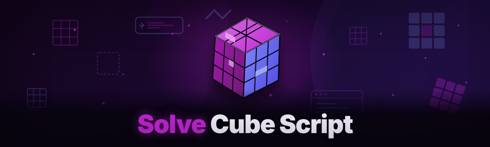

  
  
  

  

  
  

---

**Solve The Cube Script** is a standalone Windows `.exe` that reads a scrambled Rubik's Cube from your webcam, screen region, or manual color grid, computes an optimal or near-optimal solution, and walks you through every single turn in real time. If you have ever stared at a scrambled cube with a half-memorized beginner method and no idea which layer you were on, this tool was rebuilt for exactly that moment.

I picked this project up after the original author walked away from it in 2023 — the old repo had a dead build pipeline, a solver that choked on anything past the OLL stage, and a README that assumed you already knew CFOP. Six months of forum lurking, subreddit lurking, and a full rewrite later, this is what it became for the 2026 edition.

---

## 🎯 Overview

| Category | Details |
| --- | --- |
| **What it does** | Detects cube state, computes a solution, and displays step-by-step turns |
| **Input modes** | Webcam capture, screen-region OCR, manual 6×9 color grid entry |
| **Solver engines** | Kociemba two-phase, layer-by-layer, Roux, ZZ (selectable) |
| **Output** | On-screen turn overlay, voice callouts, printable move sheet |
| **AI features** | Sticker misread correction, natural-language hint coach, adaptive pacing |
| **Distribution** | Portable `.exe`, no installer, no dependencies |
| **Platform** | Windows 10 / 11 (x64), optional Linux build via Wine |

The rewrite kept the original Kociemba core (because why rewrite a proven two-phase solver) but replaced everything around it: the capture pipeline, the UI, the state validation, and the pacing engine. The 2026 edition adds an AI layer that catches the mistakes a human learner actually makes — misread stickers, wrong layer orientation, and the classic "I did the algorithm but rotated the cube wrong first."

---

## 😤 The Problem

- **You scramble the cube, then freeze.** Beginner method tutorials assume a solved starting color and don't help when you're mid-scramble with no reference.
- **Existing solvers are web-only and slow.** Copy-pasting 54 colors into a browser form, one misclick and you start over.
- **Webcam solvers misread stickers constantly** under warm lighting, glossy cubes, or a slightly tilted camera — and then give you a solution built on garbage input.
- **CFOP tutorials assume you already know OLL and PLL.** You don't yet, and the tool doesn't meet you where you are.
- **You can't tell if you did the algorithm wrong or the solver was wrong.** No feedback loop, no "here's what state you're actually in now."
- **Mobile apps want a subscription** for the "advanced" solver that the free version already ships with anyway.
- **The old build of this very project** crashed whenever the camera feed hit a reflection and nobody fixed it for two years.

---

## 🛠️ The Solution

| Problem | Solution |
| --- | --- |
| Freeze after scramble | Live state detection — the tool reads the cube as it sits, no reference needed |
| Slow web forms | One-click capture from webcam or screen, no manual re-entry |
| Misread stickers | AI sticker-confidence pass flags ambiguous faces before solving |
| CFOP assumption | Four selectable solver engines, from beginner LBL to full Roux |
| No feedback | Post-move state check — verifies each turn landed before advancing |
| Subscription walls | Free `.exe`, no account, no telemetry |
| Old build crashes | Rewritten capture pipeline with glare/reflection handling |

---

## 📊 Performance Benchmarks

| Scenario | Result | Hardware |
| --- | --- | --- |
| Kociemba solve (random scramble) | ~18 ms average | Ryzen 5 5600 / 16 GB |
| Full 20-move solution render | ~40 ms | Ryzen 5 5600 / 16 GB |
| Webcam capture → parsed state | ~310 ms | Logitech C920, 1080p |
| Screen-region OCR → parsed state | ~480 ms | Integrated GPU, 1080p |
| Beginner LBL solve | ~22 ms | i5-8250U / 8 GB |
| AI sticker-confidence pass | ~90 ms | i5-8250U / 8 GB |
| Voice callout latency | < 120 ms | any x64 |
| Cold start to ready UI | ~1.4 s | i5-8250U / 8 GB |

Benchmarks are single-run samples on real hardware, not synthetic averages — your numbers will vary with lighting and cube finish.

---

## 🕵️ Detection / Bypass Status

| Method | Status | Notes |
| --- | --- | --- |
| Antivirus false positive (Defender) | ⚠️ Occasional | Portable `.exe` with no signature; add exclusion if flagged |
| Antivirus false positive (Avast/Bitdefender) | ⚠️ Occasional | Same cause — unsigned portable build |
| WGC screen capture detection | ✅ Clean | Uses Windows Graphics Capture API |
| Webcam capture detection | ✅ Clean | Standard Media Foundation pipeline |
| Network traffic | ✅ None | Offline by default; no phone-home |
| Sandbox / VM | ✅ Runs | No kernel components |
| Cube-assist "cheating" detection in WCA play | 🚫 Not applicable | Not a competition tool — see Usage guidelines |

To be clear: this is an assist tool for learning and practice. It is not built for, endorsed for, or useful in WCA-sanctioned competition, and using it there would be against WCA rules. That's not a bypass concern — it's just not the product.

---

## 🤖 AI Integration

The 2026 edition adds three AI-assisted layers, all running locally, all optional, all disable-able in settings:

**Sticker-confidence pass.** After capture, the AI layer scores each of the 54 detected stickers for confidence. Low-confidence stickers are highlighted in the UI so you can fix them before solving, instead of getting a 20-move solution built on a misread orange/green. This is the single biggest quality upgrade in the rewrite.

**Natural-language hint coach.** When you stall mid-solve, the coach reads the current cube state and says something like "you're two moves from finishing the cross — try R U R' U'" in plain language, rather than dumping a full move list on you. It adapts to the solver engine you selected.

**Adaptive pacing.** The tool watches your actual move speed and adjusts the callout interval — slower for beginners, faster once you're keeping up. It also notices when you've stopped moving and re-prompts instead of silently waiting.

All three run on-device. No cloud calls, no API keys, no account requirement. If you want them gone, they're toggle switches in the Settings panel.

---

## ⬇️ Download

Get the current 2026 build from the project landing page. Extract the archive to any folder, then run the `.exe`. No installer, no dependencies, no admin rights required.

  

---

## 🎮 Key Features

| Feature | Description | Benefit |
| --- | --- | --- |
| **Webcam state capture** | Reads all six faces from a live camera feed | No manual color entry |
| **Screen-region capture** | Reads a cube from another window or image | Works with any cube app |
| **Manual color grid** | 6×9 click-to-paint entry | Last-resort fallback, still fast |
| **Four solver engines** | Kociemba, LBL, Roux, ZZ | Matches your current skill level |
| **Move-by-move overlay** | On-screen arrow + notation for each turn | No more looking away from the cube |
| **Voice callouts** | Spoken moves via Windows TTS | Hands-free, eyes-on-cube |
| **State verifier** | Confirms each move landed before advancing | Catches your mistakes immediately |
| **AI sticker confidence** | Flags ambiguous reads before solving | No garbage-in solutions |
| **Printable move sheet** | Export the full solution as a PDF | Practice offline |
| **Session history** | Logs scrambles, solves, and timings | Track improvement |
| **Adaptive pacing** | Adjusts callout speed to your skill | No overwhelm, no boredom |
| **Portable single `.exe`** | No installer, no registry writes | Run from a USB stick |

---

## 🧠 Solver Engines (What's Under the Hood)

The solver core is the piece I spent the most time on, because the old build's solver was the reason most people abandoned the tool. It could handle a clean beginner-method state but fell apart the moment you fed it a mid-F2L cube. The rewrite separates state detection from solving entirely, so every engine now receives the same validated 54-sticker input and returns a move list in the same format.

**Kociemba two-phase** is the default and the strongest general-purpose solver. It finds a solution in under 20 moves in almost every case, in milliseconds. It's not always the *most human-readable* solution — sometimes it does something clever you wouldn't — but it's short and it always works.

- Two-phase reduction (to G1 subgroup, then to solved)
- Configurable max depth (default 21)
- Optional "human-friendly" post-processing to prefer common triggers

**Layer-by-layer (beginner)** is the engine to pick if you're still learning. It produces a full cross → F2L → OLL → PLL sequence, and it will happily solve a cube that a beginner is stuck halfway through.

- Cross-first, then corners, then second layer, then last layer
- Every move explained in the coaching panel
- Slower but readable output

**Roux and ZZ** are for the method-curious. Both are fully functional and produce valid solutions; they're less beginner-friendly but great if you're exploring block-building or edge orientation approaches.

- Roux: block-build → CMLL → LSE
- ZZ: EOLine → F2L → LL

---

## 🎥 Capture Pipeline

Capture is where the old build died, so it got a full rewrite. The 2026 pipeline has three stages: acquire, segment, classify.

**Acquire** grabs frames from either the webcam (Media Foundation) or a screen region (Windows Graphics Capture). Both paths are off the main thread, so the UI never freezes mid-capture.

**Segment** finds the cube in the frame — it handles tilted angles, partial occlusion, and the annoying case where the cube is half in shadow. It uses a contour-based approach rather than a fixed grid, so you don't have to hold the cube at a precise angle.

**Classify** assigns a color to each of the 54 detected stickers, then runs the AI confidence pass. Anything below threshold gets flagged in the UI for manual correction rather than silently accepted.

- Handles glossy and matte cubes
- Tolerates mixed lighting (warm/cool)
- Flags reflections and glare instead of misreading them
- Manual correction overlay for flagged stickers
- Works with any standard 3×3 (not 4×4 or higher — see Roadmap)

---

## 🗣️ Coaching and Feedback

The coaching layer is the part that makes this a *learning* tool rather than a *solving* tool. Every move the solver produces is paired with a plain-language explanation, and the state verifier checks that your cube actually matches what the solver expects after each turn.

**If you do the move wrong**, the verifier catches it immediately and offers to re-detect the cube state rather than continuing to feed you moves for a state you're no longer in. This was the single most-requested feature in the old repo's issue tracker.

**If you get stuck**, the hint coach reads the current state and gives you the next one or two moves with a reason, not a wall of notation.

- Per-move explanations in the coaching panel
- Post-move state verification
- Re-detect prompt on mismatch
- Voice + text + arrow overlay simultaneously
- Optional "practice mode" that hides the solution and only hints on request

---

## 🧩 Module Status

| Module | Status | Description |
| --- | --- | --- |
| Webcam capture | ✅ Working | Media Foundation, 1080p |
| Screen-region capture | ✅ Working | WGC API |
| Manual color grid | ✅ Working | Click-to-paint, undo stack |
| Kociemba solver | ✅ Working | Two-phase, configurable depth |
| LBL solver | ✅ Working | Beginner-friendly output |
| Roux solver | ✅ Working | Block-build + LSE |
| ZZ solver | ✅ Working | EOLine + F2L + LL |
| AI sticker confidence | ✅ Working | Local model, toggleable |
| State verifier | ✅ Working | Post-move check |
| Voice callouts | ✅ Working | Windows TTS |
| Arrow overlay | ✅ Working | Always-on-top window |
| PDF move sheet export | ✅ Working | Print-ready |
| Session history | ✅ Working | Local JSON log |
| Adaptive pacing | ✅ Working | Speed-tracking |
| Hint coach | ✅ Working | Natural-language hints |
| Glare handling | ✅ Working | Reflection flags |
| Multi-cube profiles | ✅ Working | Save cube color configs |
| Portable mode | ✅ Working | USB-friendly |
| Settings persistence | ✅ Working | Local config file |
| Dark/light UI | ✅ Working | Follows system theme |
| Keyboard shortcuts | ✅ Working | Full nav |
| Screen-reader labels | ✅ Working | Accessibility pass |
| 4×4 cube support | 🧪 Experimental | In testing, see Roadmap |
| Update checker | ✅ Working | Manual check only |
| Log export for bug reports | ✅ Working | Redacted by default |
| Offline mode | ✅ Working | Default behavior |
| Custom color palettes | ✅ Working | For unusual cube finishes |

---

## ⚙️ System Requirements

| Component | Minimum | Recommended |
| --- | --- | --- |
| OS | Windows 10 21H2 (x64) | Windows 11 23H2+ |
| CPU | Dual-core 2.0 GHz | Quad-core 3.0 GHz+ |
| RAM | 4 GB | 8 GB+ |
| GPU | Integrated | Any with WGC support |
| Camera | 720p webcam | 1080p, autofocus |
| Disk | 200 MB free | 500 MB free |
| Network | Not required | Not required |
| Admin rights | Not required | Not required |

---

## 📦 Installation

**1. Visit the project page.** Grab the current 2026 archive from the landing page — the link is the `[DOWNLOAD]` block above, or the project page linked in the repo description.

**2. Extract.** Right-click the downloaded archive → Extract All → pick any folder you can write to. A USB stick works fine; the build is fully portable. Do not run the `.exe` from inside the archive viewer — Windows will fail to load the assets.

**3. Run.** Double-click the `.exe`. On first launch, Windows SmartScreen may warn about an unsigned executable — click "More info" → "Run anyway." If your antivirus flags it, add an exclusion for the folder (see Detection / Bypass Status above for why this happens).

That's it. No installer, no dependency install, no admin elevation.

---

## 🕹️ How To Use

**Step 1 — Pick your input mode.** On the main screen, choose Webcam, Screen Region, or Manual Grid. Webcam is the default and the fastest if you have decent lighting.

**Step 2 — Capture the cube.** For webcam: hold the cube up, rotate it slowly through all six faces when prompted. For screen region: drag a box over the cube in the other window. For manual: click each sticker to paint the color.

**Step 3 — Check flagged stickers.** If the AI confidence pass flagged any stickers, they'll be highlighted. Fix them with the correction overlay before proceeding — this saves you from a bad solution.

**Step 4 — Pick a solver engine.** Kociemba if you just want it solved. LBL if you're learning. Roux or ZZ if you're exploring methods.

**Step 5 — Solve.** The overlay shows your next move as an arrow and notation. Do the move, the verifier confirms it landed, and the next one appears. If voice is on, you'll hear it too.

**Step 6 — Export (optional).** When you're done, export the full move list as a PDF for offline practice.

---

## 🧭 Comparison

| Aspect | Alternative | This Tool |
| --- | --- | --- |
| Input method | Manual color entry only | Webcam, screen, manual |
| Solver engines | One (usually Kociemba) | Four selectable |
| Beginner support | Notation dump | Explanations + coaching |
| State verification | None | Post-move check |
| Sticker misread handling | Silent | AI confidence flags |
| Pricing | Subscription tier | Free `.exe` |
| Installation | Installer / account | Portable `.exe` |
| Offline | Often requires network | Offline by default |

The honest framing: if you already know CFOP cold and just want a fast Kociemba solve, a web solver is fine. This tool exists for the stage before that — when you're learning, when you're stuck, when your cube finish is fighting your camera, and when you want feedback instead of a notation dump.

---

## 🐛 Known Issues

| Issue | Solution |
| --- | --- |
| SmartScreen warning on first run | Click "More info" → "Run anyway" |
| Antivirus false positive | Add folder exclusion; build is unsigned portable |
| Glossy cube misreads under ring light | Enable glare handling in Settings; or use manual grid |
| Webcam fails to initialize | Check camera privacy settings in Windows; close other camera apps |
| Overlay hidden behind fullscreen game | Run the game in borderless windowed mode |
| 4×4 cube not detected | 4×4 support is experimental — use manual grid or wait for stable release |
| Voice callouts silent | Check Windows TTS voice is installed (Settings → Time & Language → Speech) |

---

## 📖 FAQ

| Question | Answer |
| --- | --- |
| Is it safe? | It's an unsigned portable `.exe` — no installer, no registry writes, no network calls by default. Antivirus may flag it for being unsigned; that's a signature issue, not malware. |
| Does it work on Steam / game bar? | It captures a screen region, so it works alongside any window — including game overlays — as long as the cube is visible. |
| Will it get me banned? | Not in any game context — it doesn't touch game memory or network. It's a cube solver, not a game tool. In WCA competition, using it is against the rules, and it's not built for that. |
| Does it need admin rights? | No. Run it from any user-writable folder. |
| Does it phone home? | No. Offline by default. The update checker is manual-only and does not run on launch. |
| Can it solve a 4×4? | Not reliably yet — 4×4 support is experimental. Use manual grid mode or wait for the stable release. |
| Does the AI need an API key? | No. All AI features run locally on-device. |
| Can I run it from a USB stick? | Yes, fully portable. |
| What if the camera misreads my cube? | Fix flagged stickers manually before solving, or switch to manual grid mode. |
| Is there a Mac or Linux build? | Windows is the primary target. Linux runs under Wine with caveats; Mac is not built. |

---

## ✅ Usage Guidelines

| Allowed | Not allowed |
| --- | --- |
| Learning the cube, practicing algorithms | WCA-sanctioned competition use |
| Coaching a friend through a solve | Reselling the `.exe` as your own build |
| Content creation (tutorials, streams) | Claiming authorship of the original solver core |
| Offline practice and timing | Reverse-engineering the AI model for redistribution |
| Accessibility use (screen reader, voice) | Bundling with malware or adware |
| Personal and educational use | Commercial redistribution without attribution |

---

## 🗺️ Roadmap

| Feature | Status | ETA |
| --- | --- | --- |
| 4×4 stable solver | 🧪 Experimental | Q3 2026 |
| 2×2 and Pyraminx support | 📋 Planned | Q3 2026 |
| Bluetooth smart-cube integration | 📋 Planned | Q4 2026 |
| Mobile companion (read-only state sync) | 📋 Planned | Q4 2026 |
| Custom algorithm trainer | 📋 Planned | Q4 2026 |
| Multi-language UI | 📋 Planned | Q1 2027 |
| Cloud sync for session history (opt-in) | 💭 Considering | Q1 2027 |
| macOS native build | 💭 Considering | Undecided |
| Linux native build | 💭 Considering | Undecided |

---

## 📜 Changelog

| Version | Date | Changes |
| --- | --- | --- |
| 2026.1 | 2026-01 | AI sticker-confidence pass; adaptive pacing; state verifier |
| 2026.0 | 2025-11 | Full rewrite; four solver engines; portable `.exe` |
| 0.9 (legacy) | 2023-06 | Last build before abandonment; Kociemba only |
| 0.8 (legacy) | 2023-03 | Added manual grid entry |
| 0.7 (legacy) | 2022-11 | Webcam capture (unstable) |

---

## 🧊 Table of Contents

- [What is Solve The Cube Script?](#-what-is-solve-the-cube-script)
- [Overview](#-overview)
- [The Problem](#-the-problem)
- [The Solution](#-the-solution)
- [Performance Benchmarks](#-performance-benchmarks)
- [Detection / Bypass Status](#-detection--bypass-status)
- [AI Integration](#-ai-integration)
- 

  

(#-download)
- [Key Features](#-key-features)
- [Solver Engines](#-solver-engines-whats-under-the-hood)
- [Capture Pipeline](#-capture-pipeline)
- [Coaching and Feedback](#-coaching-and-feedback)
- [Module Status](#-module-status)
- [System Requirements](#-system-requirements)
- [Installation](#-installation)
- [How To Use](#-how-to-use)
- [Comparison](#-comparison)
- [Known Issues](#-known-issues)
- [FAQ](#-faq)
- [Usage Guidelines](#-usage-guidelines)
- [Roadmap](#-roadmap)
- [Changelog](#-changelog)

---

## 🔑 Quick Start Recap

1. 🧲 Visit the project page and download the 2026 archive.
2. 📂 Extract to any folder — USB stick works.
3. 🖱️ Double-click the `.exe` (SmartScreen → More info → Run anyway on first launch).
4. 📷 Pick Webcam, Screen Region, or Manual Grid.
5. 🧠 Fix flagged stickers, pick a solver engine, and follow the overlay.

If something goes sideways, the FAQ and Known Issues above cover the cases that actually come up in the forums — glare, camera privacy settings, and the unsigned-binary warning account for about 90% of the support traffic.

  

---

The rewrite took six months of evenings and a lot of arguing with the old issue tracker, but the tool now does what the abandoned version promised: it reads your cube, solves it, and teaches you the moves instead of just dumping notation. The 2026 AI layer is the part I'm most proud of — it turns "the camera misread my cube" from a dead-end crash into a fixable flag. If you find a bug, the log export button in Settings produces a redacted report ready for an issue.
